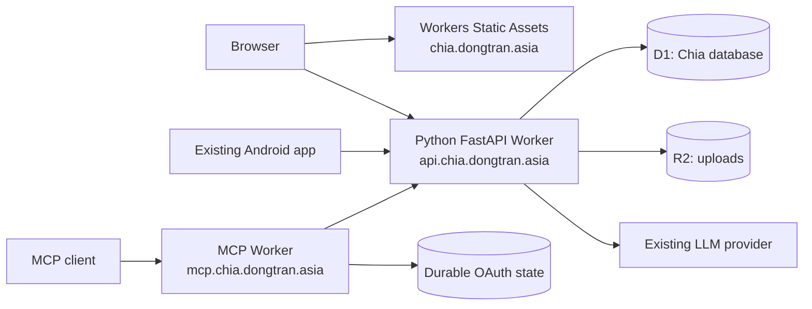

# Chia Cloudflare Migration Assessment and Plan

> **Execution update — 2026-09-18:** The user subsequently authorized a parallel
> `workers.dev` deployment without teardown. That preview is now deployed at
> https://chia.dongts1201.workers.dev with D1 and R2. The original assessment
> below records the pre-implementation state; its unchecked tasks and statements
> such as “no full backup yet” are historical, not current status. See
> [cloudflare/README.md](../../../cloudflare/README.md) for actual resources,
> verification, commands, and remaining cutover work. Production cutover and
> retirement remain excluded. MCP is not included in the deployed preview.

> **For agentic workers:** Use `superpowers:executing-plans` to execute the selected stages after the migration approach is accepted. This document is a decision-gated migration plan, not authorization to switch production or delete the Hetzner server. Runtime feasibility must be demonstrated before committing to the database refactor.

**Goal:** Retire Chia's approximately $10/month Hetzner server while preserving its data, accounting behavior, URLs, and clients, ideally within a shared $5/month Cloudflare Workers subscription.

**Architecture:** Preferred destination is Workers Static Assets for the React application, a Python/FastAPI Worker for the API, D1 for relational data, and R2 for uploads. Preserve the Python accounting services and replace their PostgreSQL access through a repository boundary. Runtime compatibility is an explicit first gate; retaining Python is a recommendation, not a proven deployment result.

**Tech stack:** Existing React/TypeScript/Capacitor frontend; Python Workers, FastAPI, Python Decimal, D1, R2; an independently deployed MCP endpoint with durable OAuth state.

**Spec:** The requirements and target architecture in this document. Assessment performed September 18, 2026 using read-only SSH inspection and current vendor documentation.

## Constraints

- Follow `CLAUDE.md` and `AGENTS.md`.
- Reuse `backend/app/services/balances.py` for group, dashboard, sidebar, and report balances. Keep monetary calculations in `Decimal` until API serialization.
- Preserve both sides of gifts and ordinary repayments, initial balances, fund deductions, and currency-specific settled thresholds.
- Preserve existing UUIDs, invitation codes, account identities, password hashes, and OAuth links.
- Keep the three existing production hostnames and `/api/v1` API contract so existing web and Android clients continue working.
- Keep the current server operational throughout development and rehearsal. Never allow independent production writes to both databases.
- Keep exports, password hashes, private account data, credentials, and signing keys out of Git and ordinary logs.
- Existing uncommitted dashboard/Android changes are separate work and must be preserved.

## 1. What is running today

Observed on `root@chia.dongtran.asia`:

| Item | Observation |
|---|---|
| Host | Ubuntu, approximately 4 GB RAM; 75 GB root filesystem, 19 GB used |
| Deployment | Docker Compose at `/root/chia/docker-compose.prod.yml` |
| Source checkout | Clean; commit `709d0494b368379f255ccd45f911d455430b9a1e`, matching local HEAD |
| Services | Caddy, static frontend, FastAPI backend, PostgreSQL 16, MCP |
| Web | `chia.dongtran.asia` |
| API | `api.chia.dongtran.asia` |
| MCP | `mcp.chia.dongtran.asia` |
| Database | 11 MB including PostgreSQL overhead; 18 application tables plus Alembic metadata |
| Accounts/groups | 106 users, 27 groups, 203 memberships; totals include historical/inactive records |
| Ledger | 578 expenses, 1,617 splits, 102 settlements, 4 funds, 17 fund transactions |
| Settlement types | 58 settle-ups, 34 transfers, 10 gifts |
| History | 534 expense logs, 252 member logs, 2,403 notifications |
| Files | 27 files, 10,139,264 bytes in Docker volume `chia_uploads` |
| Stored file references | 21 local receipt URLs, 2 local payment QR URLs; 41 external avatar URLs |
| Recent activity | 18 expenses created in seven days, 67 in thirty days |
| Available API logs | 461 request lines in the preceding 24 hours; 187 were notification GETs |
| Largest active group | 42 members |
| Password accounts | 15 bcrypt hashes using `$2b$`, cost 12 |
| Other identities | 56 users have device IDs; 45 OAuth links; these counts can overlap |
| Schema version | `a2e7f91c4b18` |

The API used approximately 212 MiB RSS during inspection. This is a Linux process measurement, not a prediction of Workers memory consumption. The log sample is not a monthly traffic baseline and does not measure all static/CDN traffic.

R2 is not configured in the running backend. Uploads and PostgreSQL live on Docker volumes on this server. Groq, Google sign-in, and Sentry are configured; secret values were not printed.

The MCP container was restarting, with over 2,500 restarts. Its logs identify an installed MCP 2.x package that no longer provides `mcp.server.fastmcp`, which this project imports. This is an existing production problem, not a migration effect. The dependency `mcp[cli]>=1.26.0` currently has no upper bound.

No root crontab or application backup timer was found in the inspected locations. This does not establish whether Hetzner snapshots or off-host backup jobs exist; verify those before decommissioning.

## 2. Options and recommendation

| Option | Code/data changes | Cost characteristics | Assessment |
|---|---|---|---|
| Python Worker + D1 + R2 | Substantial persistence refactor; runtime adapters; PostgreSQL-to-SQLite conversion | Target approximately $5/month shared across apps, within allowances | Preferred fit for the stated long-term Cloudflare goal, subject to a compatibility spike |
| TypeScript Worker + D1 + R2 | Backend and MCP rewrite plus database conversion | Same general native-service economics | Possible fallback, but discards more working Python code; requires an explicit change to the reuse strategy |
| Cloudflare Container + managed PostgreSQL + R2 | Retains most FastAPI/SQLAlchemy code; deploy/config/auth-state changes | $5 base plus container usage and any database charges | Lower migration effort; variable bill and cold starts; compare if Python Worker feasibility fails |
| Keep Hetzner, move only frontend/files | Small | Hetzner charge remains | Useful staging step, but does not achieve the cost objective |

Cloudflare supports [FastAPI on Python Workers](https://developers.cloudflare.com/workers/languages/python/packages/fastapi/) and [D1 access from Python](https://developers.cloudflare.com/d1/examples/query-d1-from-python-workers/). However, that does not make this application a drop-in deployment: the current SQLAlchemy/asyncpg database session cannot simply receive a D1 connection string. Routes contain database logic throughout approximately 4,100 lines and 94 route declarations, in addition to services.

Python packages require compatible pure-Python/WebAssembly distributions and supported networking. Audit bcrypt, JWT/cryptography, Pillow, HTTP clients, LiteLLM, Sentry, and the MCP SDK in the actual runtime. The current `httpx` and `boto3` integrations must not be presumed compatible. Prefer R2 bindings over boto3 and supported asynchronous HTTP over incompatible transports. See [Python package support](https://developers.cloudflare.com/workers/languages/python/packages/).

For the alternative, Neon is a candidate managed PostgreSQL provider with a [free plan](https://github.com/neondatabase/website/blob/main/content/faqs/free-plan-limits-and-quotas.md). A PostgreSQL dump/restore would preserve the existing SQL types and ORM. Confirm the chosen plan's compute, storage, network, recovery, and inactivity conditions before selection. A small database alone does not establish a zero bill. Notification polling every 30 seconds can keep a database/container awake.

[Hyperdrive connects to an existing database](https://developers.cloudflare.com/hyperdrive/); it does not provide the PostgreSQL hosting needed to remove Hetzner. [Container disks are ephemeral](https://developers.cloudflare.com/containers/concepts/architecture/), so moving the PostgreSQL Docker volume into a Cloudflare Container is not a durable database migration.

**Economic judgment:** Saving $5/month on Chia alone is approximately $60/year. A persistence refactor is not justified purely by that saving. It becomes more reasonable if the goal is a reusable Cloudflare deployment pattern for multiple apps and less server administration. A precise implementation estimate should follow the compatibility spike; this is a multi-stage engineering project, not a DNS-only move.

## 3. Expected native-service bill

| Component | Expected baseline for this workload | Relevant allowance |
|---|---|---|
| Workers Paid | $5/month per account, shared across apps | 10 million dynamic requests and 30 million CPU-ms per month |
| Static assets | $0 for direct static asset serving | Free static requests; avoid unnecessarily invoking API code for assets |
| D1 | $0 incremental while within included usage | Paid: 5 GB aggregate storage, 25 billion rows read/month, 50 million rows written/month |
| R2 Standard | $0 incremental while within its free allowance | 10 GB-month, 1 million Class A operations, 10 million Class B operations |
| Groq/other AI providers | Separate from hosting | Preserve current provider initially; Cloudflare hosting does not include its inference bill |

Sources: [Workers pricing](https://developers.cloudflare.com/workers/platform/pricing/), [D1 pricing](https://developers.cloudflare.com/d1/platform/pricing/), and [R2 pricing](https://developers.cloudflare.com/r2/pricing/).

At the observed rate, ten similar apps would generate roughly `461 × 30 × 10 = 138,300` API requests/month. This is an illustration, not a forecast; CPU, database scans, other account workloads, build/log usage, and abuse also affect cost. The allowances are shared, not multiplied per application. If Workers Paid is already enabled, Chia could have approximately zero incremental hosting cost while the account remains within allowances. Cloudflare account usage/billing has not been inspected.

The Free plan has a 10 ms CPU allowance per invocation. Existing cost-12 password verification and image processing must be benchmarked before promising free production operation. D1 Free also limits databases to 500 MB each, 10 databases per account, and 50 queries per invocation. Paid is the more practical initial target, especially with staging databases and 42-member groups. See [Workers limits](https://developers.cloudflare.com/workers/platform/limits/) and [D1 limits](https://developers.cloudflare.com/d1/platform/limits/).

Containers change the calculation: an always-running `basic` instance provisioned with 1 GiB memory and 4 GB disk over 730 hours costs approximately $6.35 in memory and $0.69 in disk beyond the included usage, plus the $5 base, CPU, Durable Objects, and any database charges. Sleeping reduces cost, but long-lived MCP connections and notification polling reduce sleep opportunities. This derived example uses [Container pricing](https://developers.cloudflare.com/containers/platform/pricing/); it is not a quote for this app.

## 4. Proposed destination

Use separate production and staging D1 databases, buckets, and secrets. Start with one database per app/environment, not per group. Preserve existing API response types, including the current distinction between Decimal strings and numeric fields. Do not introduce a frontend rewrite or change the AI provider as part of hosting migration.

Keep `/uploads/<filename>` working at the API hostname by serving existing R2 object keys through the Worker. Keep the bucket itself private and preserve current URL access behavior through that route. External Google avatar URLs remain external. Existing unreferenced upload files are copied too, rather than discarded during migration.

Preserve web SPA routing, service-worker update behavior, cache headers, `/.well-known/assetlinks.json`, invitation URLs, and Android Google sign-in configuration. API and MCP paths must not fall through to the SPA's `index.html`.

## 5. Database conversion design

D1 uses SQLite semantics. Produce a purpose-built D1 schema and a deterministic converter; do not feed a PostgreSQL `pg_dump` directly into D1.

| PostgreSQL representation | Proposed D1 representation |
|---|---|
| UUID | Canonical UUID `TEXT`; preserve every value |
| `NUMERIC(12,2)` | Scaled `INTEGER`, original value multiplied by 100 |
| `NUMERIC(12,4)` split values | Scaled `INTEGER`, multiplied by 10,000 |
| `NUMERIC(12,6)` exchange rates | Scaled `INTEGER`, multiplied by 1,000,000 |
| Boolean | `INTEGER` constrained to 0/1 |
| Enum | `TEXT` with equivalent allowed-value checks |
| JSONB | JSON `TEXT`, preserving value types and null distinctions |
| Timestamptz | Consistently formatted UTC text with original precision |
| Date | ISO date text |

Convert scaled values back to Python `Decimal` at the repository boundary. Never use SQLite `REAL` for money, floating-point division, or `Decimal(float_value)`. Preserve existing two-decimal stored VND values too; the one-unit settled threshold affects presentation/settlement semantics, not import rounding. Preserve all current rounding modes and remainder allocation order. Check integer/aggregate ranges and the Python-to-JavaScript binding boundary; use textual transport where necessary to prevent integer precision loss.

Import all application tables: `users`, `user_oauth`, `groups`, `group_members`, `categories`, `expenses`, `expense_splits`, `settlements`, `group_currencies`, `payment_methods`, `group_payment_methods`, `funds`, `fund_transactions`, `expense_fund_deductions`, `expense_logs`, `group_member_logs`, `notifications`, and `system_config`.

Archive the Alembic version as migration provenance; use separate D1 SQL migration history going forward. Preserve soft-deleted groups, inactive/unclaimed members, and nullable references. Handle the group/default-category relationship cycle explicitly: insert groups with null default category, import categories, then restore the references before validation. Preserve unique constraints, foreign keys, and delete behavior. Do not assume foreign-key checks can simply be switched off; follow [D1 foreign-key guidance](https://developers.cloudflare.com/d1/sql-api/foreign-keys/).

Use [D1 transactional batches](https://developers.cloudflare.com/d1/worker-api/d1-database/) for expense rows, splits, fund deductions/transactions, and related history. An exception in one statement must roll back the entire mutation. A pre-read followed by a batch does not make a fund balance check concurrency-safe: enforce funds/other mutation invariants inside the transaction using database constraints/triggers or a proven serialized mutation design. Zero affected rows do not automatically abort a batch. Include simultaneous-deduction and edit-versus-delete tests.

Batch imports within documented statement-size and bound-parameter limits. Index group membership, expense/split joins, settlements, fund transactions, notifications, and authentication lookups. Avoid multiplying full-ledger queries in the dashboard. Keep a single authoritative balance implementation while improving how it receives ledger data.

## 6. Execution stages and acceptance gates

### Stage A — Establish a baseline and recoverable backups

**Files:** `scripts/migration/export_postgres.py`, `scripts/migration/reconcile.py`, `backend/tests/test_dashboard_balances.py`, `backend/tests/test_member_analytics.py`, existing fund/distribution tests.

- [ ] Capture the deployed API/OpenAPI contract and source/image provenance; record any expected differences from the working tree.
- [ ] Create a restricted, consistent PostgreSQL custom-format dump and uploads archive outside the repository, plus SHA-256 manifests. Capture secrets through a secure channel without printing them.
- [ ] Restore the dump into an isolated PostgreSQL database and verify the restore, schema version, row counts, and upload checksums.
- [ ] On that restored snapshot, generate an exact baseline for every group/member balance, every fund balance, report totals, and suggested settlements using the current Python services. Record anomalies separately; migration must not silently repair history.
- [ ] Run `pytest tests/ -v` against the isolated `chia_test` database and `npm run build` / `npm run lint` in the frontend. Record existing failures before attributing anything to migration.

**Gate:** A proven restore and a machine-readable reconciliation baseline, not merely a successfully created dump. No writes or synthetic users on production.

### Stage B — Prove Python Workers compatibility

**Files:** future `backend/worker.py`, `backend/pyproject.toml`, `backend/wrangler.jsonc`, `backend/tests/workers/`; inspect `app/main.py`, `config.py`, `core/security.py`, `services/auth.py`, `services/file_storage.py`, `services/llm/provider.py`.

- [ ] Time-box a one-to-two-day staging spike: FastAPI request validation, one authenticated route, D1 reads plus atomic writes, R2 upload/download, and Decimal split/balance calculations.
- [ ] Verify a synthetic bcrypt cost-12 hash, existing JWT claim/algorithm compatibility, Google ID-token verification, and guest device-ID handling. Do not require real users' passwords for the test.
- [ ] Exercise the largest existing group shape and representative report queries. Measure deployed CPU, memory, cold/warm latency, and bundle limits rather than extrapolating Linux RSS.
- [ ] Exercise image resize/EXIF behavior, QR images, PDF passthrough, upload size limits, and one natural-language parsing request with the existing provider. Large Python dependencies may need narrow adapters or replacement.
- [ ] Verify error monitoring and remove unnecessary imports from the request bundle. Deployment/migrations/category seeding must run explicitly, not on each Worker invocation.
- [ ] Publish a pass/fail compatibility matrix with locked dependency versions and measured limits.

**Gate:** Proceed with Python/D1 only if the complete representative path works within paid Workers limits. If it fails, present measured blockers and choose between the container/managed-Postgres alternative and a separately approved TypeScript rewrite. Do not silently drop features or start a rewrite.

### Stage C — Build D1 schema and the reusable data boundary

**Files:** future `backend/d1/migrations/`, `backend/app/repositories/`, `scripts/migration/postgres_to_d1.py`, `backend/tests/test_d1_migration.py`; modify `backend/app/database.py` and database-dependent services/routes.

- [ ] Create the schema with the exact conversion rules above, equivalent indexes/constraints, and explicit handling of nullable/cyclic relationships.
- [ ] Implement conversion from a consistent restored snapshot, preserving identifiers, order-sensitive data, timestamps, JSON, and scaled numeric precision. Fail on unsupported/out-of-range data instead of coercing it.
- [ ] Make import retries target a fresh staging database or use an explicitly verified idempotent process; never blindly append into production.
- [ ] Adapt `balances.py` to obtain ledger records through the repository boundary while keeping the authoritative Decimal calculation in that service. Preserve `split_calculator.py` and `debt_simplifier.py` behavior.
- [ ] Reconcile per-table counts, canonical row checksums, foreign keys, exact monetary values, all member/fund balances, and reports against Stage A.

**Gate:** Zero unexplained conversion or ledger discrepancies on the same source snapshot.

### Stage D — Port all API workflows

**Files:** `backend/app/api/v1/*.py`, `backend/app/services/{auth,merge_users,notification,system_config,expense_logger,member_log,balances}.py`, repository modules, existing tests plus D1 integration tests.

- [ ] Port and verify authentication, guest upgrades/account merging, groups, invitations/claims, permissions, members, and categories first.
- [ ] Port and verify expenses, currency conversions, splits, fund contributions/withdrawals/deductions, expense edits/deletes, gifts/distributions, transfers, and settlements using atomic mutations.
- [ ] Port reports, dashboard/group-list balances, notifications, payment methods/QRs, configuration, and admin operations. Preserve soft-delete and inactive-member behavior.
- [ ] Test both sides of gifts and repayments; zero-decimal currency dust; initial balances; all four split modes; partial/full/multiple-fund coverage; restoration of funds on expense edits/deletes.
- [ ] Run requests concurrently to prove no overspending and no partial ledger writes. Compare actual response status codes, serialized types, nulls, pagination, and permission failures with the original API contract.

**Gate:** Full feature parity for the existing frontend and Android API consumers, with original regression tests and D1-specific integrity tests passing.

### Stage E — Move assets and complete integrations

**Files:** future `frontend/wrangler.jsonc`, `frontend/public/_headers`; existing `frontend/src/main.tsx`, `frontend/public/sw.js`, `frontend/public/.well-known/assetlinks.json`, `backend/app/services/file_storage.py`, `backend/app/services/llm/provider.py`; future MCP Worker deployment and durable-state adapter.

- [ ] Deploy the existing Vite build to staging with SPA fallback and correct asset/service-worker caching. Preserve the production API URL in the eventual production bundle.
- [ ] Copy all upload objects and verify checksum, size, content type, and legacy `/uploads/` URL behavior. Inspect the unusual `.null` file by content instead of guessing its MIME type from the extension.
- [ ] Preserve image processing through a measured compatible implementation; if an additional image service is necessary, price it and review that change before cutover.
- [ ] Keep the same JWT secret and Google OAuth audience securely configured, preserving existing sessions where the runtime checks confirm compatibility. Carry over superadmin configuration, Groq credentials, system configuration, and Sentry settings.
- [ ] Restore MCP compatibility with a tested SDK version and migrate its OAuth client registrations, pending authorizations, and one-use codes out of process-local dictionaries. Use strongly consistent durable storage and atomic code consumption; do not use ordinary in-memory state or eventually consistent KV for replay-sensitive transitions.
- [ ] Validate MCP discovery, client registration, Google/password authorization, PKCE, tool calls, and restart behavior with the intended client. Test all tools, not just server startup. Reauthorization may be needed for ephemeral state that was already lost in the current restart loop.

**Gate:** Browser, Android, upload, AI parsing, and MCP acceptance checks pass in staging. If MCP is to be retired instead, make that an explicit scope decision before server deletion.

### Stage F — Rehearse and cut over

**Files:** future `docs/cloudflare-operations.md`, migration/export/reconciliation scripts, deployment configurations.

- [ ] Rehearse the entire import and validation on staging, measure duration, and select a production maintenance window from that measurement. The small dataset suggests a short window, but no downtime promise is justified yet.
- [ ] At the agreed window, block production mutations at the old API/MCP entry points and stop every other writer. Drain in-flight requests. Keep a record of the freeze time.
- [ ] Take the final consistent database snapshot and final upload delta. Import and reconcile against that exact snapshot; repeat all row-count, checksum, foreign-key, balance, and fund checks.
- [ ] Switch the existing web/API/MCP hostnames to the Cloudflare deployments. Validate DNS/TLS, OAuth origins, CORS, deep links, service-worker updates, existing JWTs, and representative Android versions.
- [ ] Keep the old origin blocked from independent writes during DNS propagation; return maintenance responses or deliberately proxy it to the new authoritative API. Avoid split writes between PostgreSQL and D1.
- [ ] Run smoke tests before opening writes, then enable the new API as the sole writer and monitor errors, CPU, D1 reads/writes, and authentication.

**Gate:** Every reconciliation check passes before write traffic resumes. No mixed-backend gradual rollout while databases are independent.

### Stage G — Rollback and retire Hetzner

- [ ] Before any new D1 writes, rollback can return routing to the untouched PostgreSQL snapshot and reopen the old API after verification.
- [ ] After D1 accepts writes, DNS-only rollback would lose data. Freeze writes again and either fix forward or export D1 into a fresh PostgreSQL restore through a tested reverse converter; reconcile all rows, deletions, history, and new R2 objects before reopening the old stack. Prepare and rehearse this converter before cutover if post-write rollback is required.
- [ ] Retain the frozen server and final backups for at least seven days while validating usage and user workflows. This creates a temporary overlap in hosting charges.
- [ ] Enable daily encrypted logical exports with retention and an independent copy, and retain/protect uploaded objects separately. Test restoration, not just export creation. D1 Time Travel provides [7 days on Free or 30 days on Paid](https://developers.cloudflare.com/d1/reference/time-travel/), but it does not back up R2 objects or replace an independent recovery copy.
- [ ] Verify no remaining services, domain routes, CI jobs, or backup dependencies use the server. Only then arrange final Hetzner deletion/cancellation as a separate explicit action.

## 7. What remains to decide or measure

- Preferred path: fully Cloudflare-native versus the lower-code-change managed-PostgreSQL alternative. This plan recommends the former subject to Stage B.
- Actual Cloudflare account subscription, permissions, zone ownership, existing quotas, and total usage. These were not available through the SSH inspection.
- Runtime compatibility and production-like CPU/memory measurements, especially password hashing and image processing.
- Maintenance window and acceptable recovery objectives; proposed default is a short rehearsed write freeze, zero planned migration data loss, seven-day server retention, and daily independent backups.
- Whether MCP must remain available after migration; the plan includes it by default.

No production configuration, DNS, running services, or database records were changed during this assessment. No full production backup was created yet. Only aggregate database metadata/counts and operational information were inspected; backups and implementation are future stages.
